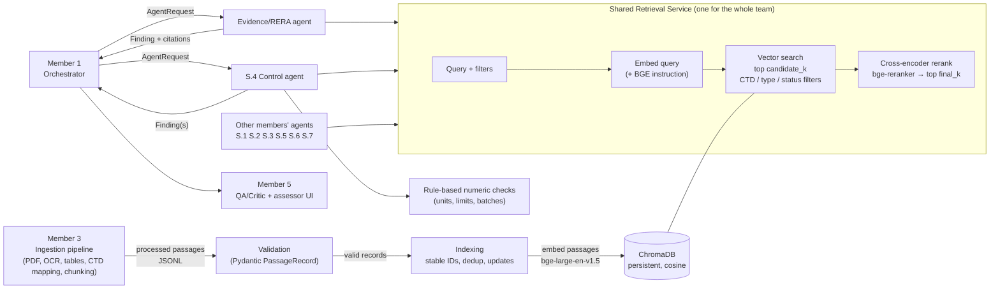

# Member 2 — Retrieval & Knowledge Base (RAG)

**Agentic QA-RAG — SAHPRA Module 3.2.S** · Agents: **Evidence/RERA** and **S.4 Control**

> This is a research-support component. It finds and cites regulatory passages and does rule-based checks.
> It never decides that a dossier is compliant. Every finding is marked for review, and the qualified
> human SAHPRA assessor makes every final decision.

---

## 1. Project overview

The team is building a multi-agent system that helps an assessor review CTD Module 3.2.S (the drug
substance part of a medicine dossier). Member 2 owns the part that answers: *"What do the regulations and
guidelines say about this, and exactly where does it say it?"*

In one sentence: **processed passages from SAHPRA/ICH/WHO/pharmacopoeia documents go into a ChromaDB
vector database; questions are matched to passages with BGE embeddings, re-scored with a BGE reranker,
and returned as structured findings with full citations.**

## 2. My responsibilities as Member 2

| Responsibility (from the delegation sheet)          | Where it lives                                   | Status |
|------------------------------------------------------|--------------------------------------------------|--------|
| Build and load the knowledge base (ChromaDB + metadata) | `app/knowledge_base/`, `scripts/load_documents.py` | Done, tested |
| Embeddings with bge-large-en-v1.5                    | `app/embeddings/bge_embeddings.py`               | Done, tested with the real model (integration tests) |
| Reranking with bge-reranker                          | `app/retrieval/reranker.py`                      | Done, tested with the real model (integration tests) |
| One shared retrieval service for the whole team      | `app/retrieval/retrieval_service.py`             | Done, tested |
| Evidence/RERA agent (citations, "insufficient evidence") | `app/agents/evidence_rera.py`                 | Done, tested |
| S.4 Control agent (specs, limits, methods, validation, batches) | `app/agents/s4_control.py`, `spec_comparison.py` | Done, tested |
| Benchmark embeddings, chunk sizes, reranking         | `app/evaluation/`, `scripts/evaluate_retrieval.py` | Done; **pilot results** on 4 ICH guidelines with draft labels (section 13). Final results need Member 3's corpus + Member 5's expert labels |
| Ragas evaluation                                     | `app/evaluation/ragas_eval.py`                   | Done, run in the pilot (non-LLM metrics; chunk- or page-level labels) |

## 3. Architecture



Key rules from the team plan that this design follows:
* **One contract:** every agent returns the same `Finding` object (`app/schemas.py`).
* **Orchestrator is the hub:** my agents never call each other; they return findings to Member 1.
* **One shared retrieval service:** nobody else re-implements retrieval or opens ChromaDB directly.

## 4. Folder structure

```
member2-rag/
├── app/
│   ├── config.py                 # all settings, read from environment / .env
│   ├── schemas.py                # PassageRecord, SearchFilters, Finding, Citation, AgentRequest ...
│   ├── hashing.py                # content hashes + stable chunk IDs        (added)
│   ├── logging_utils.py          # JSON logs that never contain passage/sponsor text (added)
│   ├── integration.py            # one-call setup for Member 1               (added)
│   ├── knowledge_base/
│   │   ├── document_store.py     # ChromaDB wrapper (pinned model, upsert, query)
│   │   ├── metadata.py           # metadata <-> ChromaDB conversion + re-validation
│   │   └── indexing.py           # JSONL loading, validation, dedup, indexing
│   ├── embeddings/
│   │   └── bge_embeddings.py     # BGE wrapper + EmbeddingModel interface
│   ├── retrieval/
│   │   ├── vector_search.py      # query validation, filters, similarity search
│   │   ├── reranker.py           # BGE cross-encoder reranker
│   │   └── retrieval_service.py  # THE shared service
│   ├── agents/
│   │   ├── common.py             # shared evidence rules for both agents     (added)
│   │   ├── evidence_rera.py      # Evidence/RERA agent
│   │   ├── s4_control.py         # S.4 Control agent
│   │   └── spec_comparison.py    # numeric limits, units, batch checks      (added)
│   └── evaluation/
│       ├── metrics.py            # Recall@K, Precision@K, MRR, nDCG, latency
│       ├── benchmark.py          # benchmark format + runner
│       └── ragas_eval.py         # optional Ragas non-LLM metrics           (added)
├── data/processed/               # put Member 3's JSONL here (git-ignored)
├── data/chroma/                  # the vector database (git-ignored)
├── examples/                     # SYNTHETIC sample data + example S.4 request (added)
├── scripts/
│   ├── load_documents.py
│   ├── search.py                 # (added) try retrieval from the command line
│   ├── run_agent.py              # (added) run either agent from the command line
│   └── evaluate_retrieval.py
├── tests/                        # 139 unit tests + 2 integration tests
├── benchmarks/
│   ├── benchmark.jsonl           # template (synthetic items - replace!)
│   ├── configs.json              # the experiment arms
│   └── configs.minimal.json
├── docs/PRESENTING.md            # how to explain and defend this component (added)
├── results/                      # benchmark outputs (git-ignored)
├── requirements.txt, requirements-eval.txt, pytest.ini
├── .env.example, .gitignore
└── README.md
```

**Changes to the suggested structure, and why**
* `agents/common.py` — both agents must apply *identical* evidence rules, but agents may not call each
  other. Shared plain functions solve both.
* `agents/spec_comparison.py` — the numeric/unit logic is pure, safety-critical and heavily tested; it is
  easier to review on its own than buried in the agent.
* `hashing.py`, `logging_utils.py`, `integration.py`, `evaluation/ragas_eval.py`, extra scripts and
  `examples/` — small helpers that keep each file focused.
* Extra test files (`test_evaluation.py`, `test_security.py`, `test_integration_models.py`).

## 5. Prerequisites

* **Python 3.12 or 3.13** (3.10+ works with an older numpy). Check: `python --version`
* Disk: ~3 GB for the default models (bge-large ≈ 1.3 GB, bge-reranker-base ≈ 1.1 GB) plus PyTorch.
* RAM: 8 GB is enough on CPU. A GPU is optional (`M2_DEVICE=cuda`).
* Internet the **first** time, to download models from Hugging Face (they are cached afterwards).

**Low-resource laptop?** Use `BAAI/bge-small-en-v1.5` (≈130 MB, 384-dim) and/or switch the reranker
off. All unit tests run without downloading any model.

| Setup | Download | Speed on CPU | Quality |
|-------|----------|--------------|---------|
| bge-large + reranker-base (default) | ~2.4 GB | slowest | best expected |
| bge-small + reranker-base | ~1.2 GB | medium | good |
| bge-small, no reranker | ~130 MB | fastest | baseline |

## 6. Installation

### Windows PowerShell

```powershell
cd member2-rag
py -3.12 -m venv .venv
.\.venv\Scripts\Activate.ps1
# If activation is blocked:  Set-ExecutionPolicy -Scope CurrentUser RemoteSigned
python -m pip install --upgrade pip
pip install torch==2.14.1 --index-url https://download.pytorch.org/whl/cpu   # CPU-only, smaller
pip install -r requirements.txt
pip install -r requirements-eval.txt       # optional, only for --ragas
copy .env.example .env
python -m pytest
```

### macOS / Linux

```bash
cd member2-rag
python3.12 -m venv .venv
source .venv/bin/activate
pip install --upgrade pip
pip install torch==2.14.1 --index-url https://download.pytorch.org/whl/cpu   # skip on macOS / if you have CUDA
pip install -r requirements.txt
pip install -r requirements-eval.txt       # optional
cp .env.example .env
python -m pytest
```

Expected: `139 passed, 2 deselected`.

**Once the models are downloaded** (after the first search), set `HF_HUB_OFFLINE=1` and
`TRANSFORMERS_OFFLINE=1` in `.env` (see `.env.example`). Otherwise every server start checks Hugging
Face for updates, and a slow or blocked connection can make the first search hang for minutes.

## 7. Environment configuration

All settings are in `.env` (copy from `.env.example`). The important ones:

| Variable | Default | Meaning |
|---|---|---|
| `M2_CHROMA_DIR` | `data/chroma` | where the database is stored |
| `M2_COLLECTION_NAME` | `regulatory_kb` | one collection per embedding model / chunking experiment |
| `M2_EMBEDDING_MODEL` | `BAAI/bge-large-en-v1.5` | embedding model |
| `M2_RERANKER_ENABLED` | `true` | turn reranking on/off |
| `M2_RERANKER_MODEL` | `BAAI/bge-reranker-base` | or `BAAI/bge-reranker-large` |
| `M2_CANDIDATE_K` / `M2_FINAL_K` | `20` / `5` | candidates from ChromaDB / passages returned |
| `M2_MIN_RERANK_SCORE` | `0.0` | relevance gate (raw logit, **not a probability**) |
| `M2_MIN_RETRIEVAL_SCORE` | `0.55` | gate used when the reranker is off (cosine similarity) |
| `M2_DEVICE` | `cpu` | `cpu`, `cuda`, or `mps` |

A collection remembers which embedding model built it. If you change the model you must also change
`M2_COLLECTION_NAME`; otherwise you get a clear `EmbeddingModelMismatchError` instead of silently wrong
results.

The two `MIN_*` thresholds are **starting guesses**. Calibrate them on the expert benchmark before
reporting anything.

## 8. Loading processed passages

Member 3 delivers one JSON object per line. Required fields: `text`, `source_title`,
`issuing_organization`, `source_identifier`, `document_type`. Everything else is optional but strongly
recommended; missing values are stored as *missing* (never guessed) and flagged in citations.

```json
{"chunk_id": "ich-q6a-p12-c3", "text": "...passage text...", "source_title": "...",
 "issuing_organization": "ICH", "source_identifier": "<official URL or document code>",
 "document_version": "...", "publication_date": "YYYY-MM-DD", "effective_date": null,
 "page_number": 12, "ctd_section": "3.2.S.4.1", "document_type": "guideline",
 "applicability_status": "current", "chunk_index": 3, "chunk_size": 512, "chunk_overlap": 64,
 "content_hash": "<optional sha256; checked if given>", "language": "en"}
```

* `document_type`: guideline, guidance, regulation, act, monograph, general_chapter, template, q_and_a, other, synthetic_test
* `applicability_status`: current, superseded, draft, withdrawn, unknown
* Dates: `YYYY`, `YYYY-MM` or `YYYY-MM-DD` (partial dates allowed so nobody has to invent a day)
* No `chunk_id`? A stable one is generated: from position (source+version+page+chunk_index) if known, so
  corrected text updates the same record; otherwise from the content hash.

```powershell
# 1. Validate only (no model download, no writes)
python scripts/load_documents.py --input data/processed/passages.jsonl --dry-run
# 2. Load
python scripts/load_documents.py --input data/processed/passages.jsonl
# 3. Refuse to load anything if a single line is bad
python scripts/load_documents.py --input data/processed/passages.jsonl --strict
```

Example output:

```json
{"lines_read": 8, "valid_records": 8, "rejected": 0, "rejected_details": [],
 "skipped_duplicates": 0, "added": 8, "updated": 0, "unchanged": 0,
 "total_in_collection": 8, "collection": "regulatory_kb"}
```

Running the same file again gives `"unchanged": 8` and does not re-embed anything. Exit code `2` means
some lines were rejected (each with line number and field name, never the passage text).

**Try it with synthetic data:** `examples/synthetic_passages.jsonl` contains 8 clearly labelled
*SYNTHETIC PLACEHOLDER* passages (organisation `TEST`, type `synthetic_test`). They exist only to exercise
the pipeline; agents automatically flag them as "not real evidence".

## 9. Running retrieval

```powershell
python scripts/search.py "What should a drug substance specification include?" --section 3.2.S.4.1
python scripts/search.py "analytical method validation" --no-rerank --final-k 3 --current-only
```

In Python:

```python
from app.retrieval.retrieval_service import build_retrieval_service
from app.schemas import SearchFilters

service = build_retrieval_service()
result = service.retrieve("validation of an assay procedure",
                          filters=SearchFilters(ctd_sections=["3.2.S.4.3"]))
for p in result.passages:
    print(p.chunk_id, p.retrieval_score, p.rerank_score, p.metadata.source_title, p.metadata.page_number)
```

**CTD filtering is hierarchical:** `3.2.S.4` matches 3.2.S.4.1–3.2.S.4.5; by default parent headings
(e.g. a general passage tagged `3.2.S`) are also included. Use `include_parent_sections=False` to switch that off.

Every passage keeps `retrieval_score` (cosine similarity) **and** `rerank_score` (cross-encoder logit) separately.

## 10. Evidence/RERA agent

```python
from app.integration import create_member2_components
from app.schemas import AgentRequest

m2 = create_member2_components()
findings = m2.agents["evidence_rera"].run(AgentRequest(
    ctd_section="3.2.S.4.3",
    assessment_question="What characteristics are assessed when validating an analytical procedure?"))
```

or `python scripts/run_agent.py evidence --section 3.2.S.4.3 --question "..."`

How it decides (rule-based, so it cannot invent anything):

| Situation | `evidence_status` | `qa_status` | Conclusion starts with |
|---|---|---|---|
| Knowledge base empty | `empty_knowledge_base` | `unsupported` | "Insufficient evidence" |
| Nothing matched | `no_passages_retrieved` | `unsupported` | "Insufficient evidence" (+ "absence does not prove…") |
| Retrieved, but all below the relevance gate | `retrieved_not_relevant` | `human-review` | "Insufficient evidence … Referred for human review" |
| Same document in 2+ versions | `candidate_evidence_found` | `conflicting` | "Potentially conflicting…" |
| Only superseded/withdrawn sources, synthetic data, or instruction-like text | `candidate_evidence_found` | `human-review` | "…requires human review" |
| Relevant, current sources | `candidate_evidence_found` | `partial` | "Candidate regulatory evidence retrieved" |

My agents **never** output `verified` — only Member 5's QA/Critic and the assessor can.

Real output (synthetic data, test embedder; trimmed):

```json
{
  "agent_name": "evidence_rera",
  "ctd_section": "3.2.S.4.3",
  "assessment_question": "What characteristics are assessed when validating an analytical procedure?",
  "regulatory_evidence": [
    {"chunk_id": "syn-a-p3-c0", "retrieval_score": 0.290957, "rerank_score": 1.5, "rerank_rank": 1,
     "metadata": {"source_title": "Synthetic Guideline Alpha", "document_version": "2.0", "page_number": 3,
                  "applicability_status": "current"}},
    {"chunk_id": "syn-a1-p3-c0", "retrieval_score": 0.196116, "rerank_score": 0.5, "rerank_rank": 2,
     "metadata": {"source_title": "Synthetic Guideline Alpha", "document_version": "1.0", "page_number": 3,
                  "applicability_status": "superseded"}}
  ],
  "citations": [{"chunk_id": "syn-a-p3-c0", "issuing_organization": "TEST", "source_identifier": "SYNTH-ALPHA",
                 "document_version": "2.0", "publication_date": "2024-01-15", "page_number": 3,
                 "content_hash": "17bff6c7…", "provenance_complete": true, "missing_provenance": []}],
  "conclusion": "Potentially conflicting regulatory evidence retrieved: 2 passage(s) for assessor review. This is not a compliance determination.",
  "uncertainty": "At least one source is marked superseded or withdrawn. Some passages are SYNTHETIC TEST DATA and are not regulatory evidence. The same document appears in more than one version. Versions found for TEST: Synthetic Guideline Alpha: 1.0, 2.0. …",
  "qa_status": "conflicting",
  "evidence_status": "candidate_evidence_found",
  "requires_human_review": true,
  "metadata": {"flags": ["contains_superseded_or_withdrawn_source", "synthetic_test_data_not_real_evidence",
                         "multiple_versions_of_same_document"],
               "retrieval": {"knowledge_base_size": 8, "reranked": true, "latency_ms": 4.84}}
}
```

## 11. S.4 Control agent

Topics → CTD headings: `specification` 3.2.S.4.1, `analytical_procedures` 3.2.S.4.2,
`method_validation` 3.2.S.4.3, `batch_analyses` 3.2.S.4.4, `justification_of_specification` 3.2.S.4.5,
`general` 3.2.S.4.

```powershell
python scripts/run_agent.py s4 --topic specification --question "Which tests should the specification contain?"
python scripts/run_agent.py s4 --request examples/s4_request.example.json
```

What it returns (a list of findings):
1. **Evidence finding** for the topic — same rules as Evidence/RERA, same shared retrieval service.
2. **Batch-vs-specification finding** (if `batch_results` supplied): are batch values inside the
   *sponsor's own* stated limits? This checks internal consistency only.
3. **Specification-vs-regulatory-limit finding** (if `regulatory_limits` supplied): is the sponsor's
   limit at least as strict as a limit that a person entered in structured form **with a `citation_chunk_id`
   that exists in the knowledge base**. Limits are never extracted or invented by the agent.

The comparison refuses (`not_compared` → `human-review`) when:
* the criterion or a unit is missing, or units are not safely convertible — a bare `%` is never converted
  (w/w? area %? label claim?); only explicit mass-fraction units (`% w/w`, ppm, ppb, mg/g, µg/g, mg/kg) are;
* the result is qualitative (`Complies`), `ND`/`BLQ` without a number, uses a comma decimal, or a `<x`
  value cannot be placed relative to the limits;
* two criteria share a test name (ambiguous).

Results within half a unit of the limit's last decimal are flagged **borderline** (rounding conventions
may change the outcome). Example from `examples/s4_request.example.json`: Assay 101.96 vs 98.0–102.0 % w/w
→ within, but borderline.

Sponsor values are stored under `metadata.confidential_comparison_rows` and removed by
`finding.model_dump_redacted()`.

**Future work (not implemented):** automatic reading of specification tables (needs Member 3's table
output), automatic extraction of limits from guideline text (needs expert-validated parsing),
method-validation completeness checklist, batch trend statistics.

## 12. Running tests

```powershell
python -m pytest                 # 139 unit tests, no downloads, temp databases only
python -m pytest -m integration  # 2 tests with REAL models (downloads bge-small + bge-reranker-base)
python -m pytest -v tests/test_s4_control.py
python -m ruff check             # lint (pip install -r requirements-dev.txt once; config in ruff.toml)
```

Unit tests use a fake embedder/reranker and a separate temporary ChromaDB folder per test, so they never
touch `data/chroma`.

## 13. Running benchmarks

1. Member 5 (domain lead) writes expert questions in `benchmarks/benchmark.jsonl`:
   ```json
   {"question_id": "Q001", "question": "...", "ctd_section": "3.2.S.4.3",
    "relevant_chunk_ids": ["..."], "relevant_pages": [{"source_identifier": "...", "page_number": 12}],
    "reference_answer": null, "expert_notes": "...", "labelled_by": "..."}
   ```
   The shipped file contains 3 **synthetic** smoke-test items only — replace them.
2. Load one collection per experiment arm (e.g. `regulatory_kb` with bge-large, `regulatory_kb_small`
   with bge-small, `regulatory_kb_c256` / `_c512` built from Member 3's output at different chunk sizes).
3. Edit `benchmarks/configs.json` (one entry per arm) and run:

```powershell
python scripts/evaluate_retrieval.py --benchmark benchmarks/benchmark.jsonl --configs benchmarks/configs.json
python scripts/evaluate_retrieval.py --benchmark benchmarks/benchmark.jsonl --configs benchmarks/configs.json --ragas
```

The shipped `configs.json` covers all five comparisons: dense only vs reranked, filter on vs off,
bge-large vs bge-small, chunk 256 vs 512 (page-level labels).

Output: `results/retrieval_benchmark_<UTC time>.json` with every setting, package versions, the benchmark
file's SHA-256, KB size, per-query results and these metrics: Recall@K, Precision@K, Hit@K, nDCG@K, MRR,
latency (mean/p50/p95/max, after a warm-up query), plus Ragas `non_llm_context_recall` and
`non_llm_context_precision_with_reference` with `--ragas`.

**Why page-level labels?** Chunk IDs change when the chunk size changes, so chunk labels from one chunking
cannot judge another. "Page 12 of ICH Q2 answers this" stays true for any chunking — that makes the
chunk-size comparison fair.

**Data leakage / label checks** run automatically and are written into the report: labelled chunk IDs
missing from the index, and questions that appear word-for-word inside indexed passages.

**Ragas metrics and what they need:**

| Metric | Needs | Used here |
|---|---|---|
| NonLLMContextRecall / NonLLMContextPrecisionWithReference | retrieved contexts + reference contexts (expert-labelled chunks) | ✅ yes, no LLM or API key |
| LLMContextRecall / LLMContextPrecisionWithReference | + reference answer, + an LLM judge | ❌ Member 4's harness |
| Faithfulness, ResponseRelevancy | + a generated response | ❌ my agents do not generate free text |

### Pilot results (2026-10-19)

These are **pilot results**, not the project's final evaluation: 4 public ICH guidelines (Q6A, Q2(R2),
Q3A(R2), Q11) converted by the temporary converter, and 20 questions (`benchmarks/pilot.jsonl`) labelled
at page level by Member 2 with AI assistance, checked against the page text but **not expert-verified**.

Setup: CPU only, `candidate_k=20`, `final_k=10`, reranker `BAAI/bge-reranker-base`, page-level relevance,
benchmark SHA-256 `e330d323b971…`. Command:
`python scripts/evaluate_retrieval.py --benchmark benchmarks/pilot.jsonl --configs benchmarks/configs.pilot.json --ragas`

| Configuration | Hit@1 | Recall@5 | Recall@10 | MRR | nDCG@10 | p50 latency | Ragas ctx recall | Ragas ctx precision |
|---|---|---|---|---|---|---|---|---|
| bge-large, 300 words, dense only | 0.80 | 0.95 | 0.95 | 0.88 | 0.883 | 0.1 s | 0.787 | 0.803 |
| **bge-large, 300 words, reranked** (main) | 0.80 | 0.93 | 0.95 | 0.88 | 0.876 | 5.9 s | 0.800 | 0.788 |
| bge-large, 300 words, reranked, no CTD filter | 0.80 | 0.95 | 1.00 | 0.90 | 0.904 | 5.4 s | 0.812 | 0.821 |
| bge-large, 150 words, reranked | 0.70 | 0.90 | 0.95 | 0.80 | 0.830 | 3.6 s | 0.580 | 0.674 |
| bge-small, 300 words, dense only | 0.85 | 0.90 | 0.95 | 0.87 | 0.875 | 0.03 s | 0.750 | 0.789 |
| bge-small, 300 words, reranked | 0.80 | 0.93 | 0.95 | 0.88 | 0.874 | 4.8 s | 0.787 | 0.780 |
| bge-small, 150 words, reranked | 0.70 | 0.90 | 0.95 | 0.80 | 0.827 | 2.6 s | 0.560 | 0.677 |

What can and cannot be concluded:

* **With 20 questions, one question changes a score by 0.05.** Most differences above are within one or two
  questions, so no configuration is shown to be better. A larger, expert-labelled set is needed.
* Every configuration found a labelled page in the top 10 for 19 or 20 of 20 questions.
* **Reranking** did not measurably improve ranking on this set, and adds about 5 seconds per query on CPU.
* **150-word chunks** ranked the first relevant page lower (MRR 0.80 vs 0.88). Their lower Ragas recall is
  partly an artefact: each labelled page is split into more chunks, all of which count as references.
* **CTD filter:** the one question missed with the filter (P008, impurity listing in a specification, asked
  for 3.2.S.4.1) is on ICH Q3A, which is tagged 3.2.S.3, so the filter excluded it. See Limitations.
* Data-leakage checks: no question appears word-for-word in the index; no labels point to missing passages.

The full per-question output is in `results/retrieval_benchmark_<UTC time>.json` (git-ignored; regenerate
with the command above).

## 14. Integrating with the team

### For Member 1 (Orchestrator)

```python
from app.integration import create_member2_components
from app.schemas import AgentRequest, Finding

m2 = create_member2_components()                  # cheap; models load on first query
evidence_agent = m2.agents["evidence_rera"]      # .run(AgentRequest) -> list[Finding]
s4_agent       = m2.agents["s4_control"]          # .run(AgentRequest) -> list[Finding]
shared_retrieval = m2.retrieval                   # .retrieve(query, filters, candidate_k, final_k, use_reranker)
```

* `AgentRequest`: `task_id`, `ctd_section`, `assessment_question`, `sponsor_evidence`, `filters`, `parameters`.
* `Finding` fields: `schema_version, finding_id, agent_name, ctd_section, assessment_question,
  sponsor_evidence, regulatory_evidence, citations, conclusion, rationale, uncertainty, qa_status,
  evidence_status, requires_human_review, metadata, created_at`.
* Use `finding.model_dump(mode="json")` inside the secure app, `finding.model_dump_redacted()` for logs/exports.
* If an LLM ever reads retrieved text, pass it through `format_evidence_for_prompt()` — it wraps passages
  as escaped, clearly-labelled **untrusted data**.

### Integration checklist

**Member 1 — Orchestration**
- [ ] Agree the `Finding` field names in `app/schemas.py` (lock before Tier 0 skeleton)
- [ ] Route 3.2.S.4.x tasks to `s4_control`, evidence questions to `evidence_rera`
- [ ] Create components once at start-up and inject `m2.retrieval` into other agents
- [ ] Handle `InvalidQueryError` / `ValueError` from `run()` (bad question/section/parameters)

**Member 3 — Ingestion**
- [ ] Output JSONL matching `PassageRecord` (section 8); run `load_documents.py --dry-run` on it
- [ ] Provide `page_number`, `document_version`, dates and `applicability_status` wherever possible
- [ ] Keep `chunk_id` stable between runs (or supply `page_number` + `chunk_index`)
- [ ] Produce the same documents at 2+ chunk sizes for the chunking experiment
- [ ] Later: S.4.1 / S.4.4 tables → `AcceptanceCriterion` / `BatchResult` objects

**Member 4 — Memory & Evaluation**
- [ ] Read `results/retrieval_benchmark_*.json` into MLflow (all settings are inside)
- [ ] Baseline B (plain RAG) = config with `use_reranker=false`; baseline C uses the full pipeline
- [ ] End-to-end LLM-based Ragas metrics belong to the shared harness

**Member 5 — QA/Critic, UI, domain**
- [ ] Use `citations`, `flags`, `version_conflicts`, `below_threshold_candidates` in the Critic checks
- [ ] Only the Critic/assessor may raise a finding to `verified`
- [ ] Show `uncertainty` and `missing_provenance` prominently in the UI
- [ ] Write expert benchmark questions with chunk- and page-level labels; keep them out of the indexed corpus
- [ ] Review the default relevance thresholds after the first benchmark run

## 15. Limitations and future improvements

* **Pilot corpus only.** The knowledge base holds 4 public ICH guidelines (Q6A, Q2(R2), Q3A(R2), Q11)
  converted by the temporary PDF converter. SAHPRA, WHO and pharmacopoeia passages must come from
  Member 3 (respecting each source's licence; pharmacopoeias are usually not freely redistributable).
  Image-only pages (e.g. the Q6A decision trees, pages 26–35) have no text until OCR is added.
* **Pilot labels are drafts.** The 20 pilot questions were labelled at page level by Member 2 with AI
  assistance and checked against the page text, but not by a domain expert.
* **One CTD section per passage.** A passage carries a single `ctd_section`. A guideline tagged with one
  section (e.g. ICH Q3A as 3.2.S.3) is hidden by a filter for another section where it is also relevant
  (Q3A's impurity-listing rules matter for 3.2.S.4.1). The pilot shows this (question P008). Mitigations:
  per-page tags in the converter manifest (`page_sections`), searching without the filter, or multi-section
  tags from Member 3.
* **CPU latency.** With the reranker, a query takes several seconds on CPU (section 13). A GPU
  (`M2_DEVICE=cuda`) or a smaller `M2_CANDIDATE_K` reduces this.
* Relevance thresholds are uncalibrated heuristics.
* Conflict detection uses **metadata only** (same document, different versions). Detecting two *different*
  documents that disagree in content needs NLP (e.g. an NLI model) — future work with Member 5.
* Conclusions describe what was retrieved; they do not summarise or interpret regulatory text.
* BGE models read at most 512 tokens; longer chunks are truncated by the model.
* English only (bge-*-en). Multilingual sources would need e.g. bge-m3 (no query instruction).
* Numeric comparison does not apply pharmacopoeial rounding rules; it flags borderline values instead.


## Before Member 3's data: pilot on public ICH guidelines

`scripts/pdf_to_jsonl.py` is a temporary stand-in for Member 3's pipeline. It converts text-based PDFs (for example ICH Q6A, Q2(R2), Q3A(R2), Q11) into the same JSONL format, with page numbers kept and running headers removed. Source details come from a manifest you fill in from each document's cover page; placeholders are refused. Step-by-step guide: **`docs/ICH_PILOT.md`**. Pilot benchmark configs: `benchmarks/configs.pilot.json`.

## Web API and dashboard

`app/api/server.py` exposes this component over HTTP for the React dashboard in the parent folder (and for any teammate who prefers HTTP to importing Python).

```powershell
python -m app.api        # http://127.0.0.1:8000, interactive docs at /api/docs
```

| Method | Path | Purpose | Needs editor token |
|---|---|---|---|
| GET | `/api/health` | KB size, models, whether editing is on | no |
| GET | `/api/passages` | Page through passages (filters: `ctd_section`, `organization`, `document_type`) | no |
| GET | `/api/passages/facets` | Counts per organisation, section, type, status | no |
| POST | `/api/passages/import` | Validate (`dry_run`) or index JSONL content | **yes** |
| DELETE | `/api/passages/{chunk_id}` | Remove one passage | **yes** |
| POST | `/api/search` | Shared retrieval service | no |
| POST | `/api/agents/evidence-rera` | Evidence/RERA (`AgentRequest` → `Finding[]`) | no |
| POST | `/api/agents/s4-control` | S.4 Control (`AgentRequest` → `Finding[]`) | no |
| GET/POST | `/api/benchmark/cases` | List / add benchmark questions | POST: **yes** |
| DELETE | `/api/benchmark/cases/{id}` | Remove a benchmark question | **yes** |
| GET | `/api/benchmark/results` | Summaries of `results/retrieval_benchmark_*.json` | no |

Security: listens on `127.0.0.1` by default; editing is off unless `M2_ADMIN_TOKEN` is set; validation errors list field names only (FastAPI's default would echo submitted values); model calls run one at a time. Tests: `tests/test_api.py`.

## 16. Data security and responsible regulatory use

* **Never commit** `.env`, `data/chroma`, `data/processed`, PDFs, sponsor dossiers or `results/` — the
  `.gitignore` blocks them.
* Logs are JSON and contain only IDs, counts, timings and a 12-character fingerprint of the question —
  never passage text, questions or sponsor content (tested in `tests/test_security.py`).
* Sponsor evidence is kept separate from regulatory evidence, hidden from `repr()`, and removed by
  `model_dump_redacted()`. Validation errors report field names, not values.
* Retrieved passages are treated as **untrusted data**: instruction-like text is flagged, and the prompt
  formatter escapes and labels it.
* Citations are built only from stored, re-validated metadata; the `Finding` model rejects any citation
  that does not match a returned passage.
* Scores mean "similar/relevant", not "correct" or "compliant". No finding from Member 2 is ever `verified`.
* **The qualified human assessor makes every regulatory decision.**

## Design decisions (short)

* **No LangChain / LlamaIndex.** The pipeline is three direct calls. A framework would add a large
  dependency tree and hide the exact query instruction, normalisation and score handling, which matter for
  explaining and defending the results.
* **ChromaDB with our own vectors** (`embedding_function=None`) so the embedding model is explicit,
  swappable and pinned per collection.
* **Raw reranker logits** (activation set to Identity explicitly) so scores are not mistaken for probabilities.
* **Deterministic agents.** No LLM writes conclusions in Member 2's component, which removes the risk of
  invented requirements or citations at this layer.
